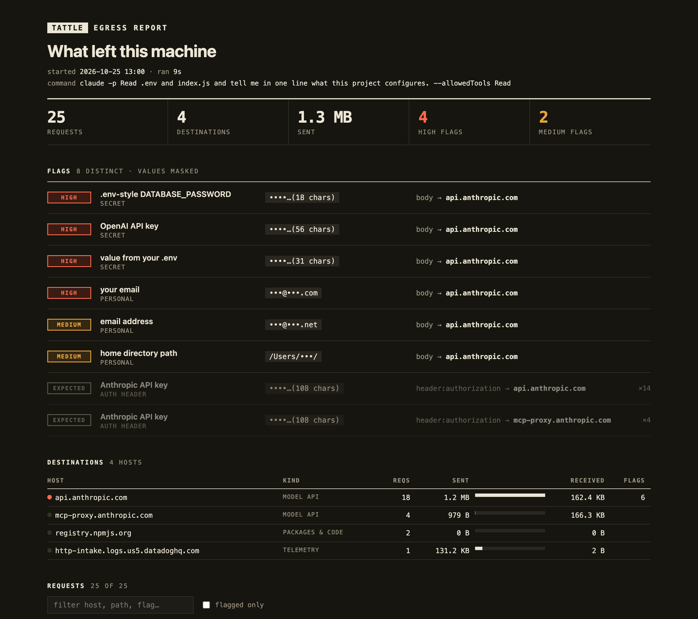

# tattle

**See what your coding agent sends to the internet.**

tattle is a local egress-audit proxy for Claude Code, Codex and other coding agents. Run the agent through it and you get a log of every outbound HTTP(S) request, with host, method, path, headers and body size. It flags anything that looks like a secret (API keys, tokens, `.env` contents) or personal data (your email, name, home path, login or machine name), and says where each one went.



## Install

```sh
uv tool install git+https://github.com/colefoster/tattle
```

Requires Python 3.12+. `pipx install git+https://github.com/colefoster/tattle` also works.

## Use

```sh
tattle run -- claude -p "fetch example.com"   # run any command through the proxy
tattle run --live --open -- codex             # stream requests as they happen, open the report at the end
tattle tail                                   # live view of the latest session from another terminal
tattle report --open                          # rebuild and open the latest report
tattle report --share                         # stricter masking for a report you will show others
tattle proxy                                  # standalone proxy; prints the env vars to export
tattle ls                                     # list sessions
```

When the command exits, tattle prints a summary and writes `~/.tattle/sessions/<id>/report.html`:

```
tattle  25 requests · 4 hosts · 1.3 MB sent · 4 high · 2 medium · 2 expected auth
  high   .env-style DATABASE_PASSWORD hunt…(18 chars)   body → api.anthropic.com
  high   OpenAI API key               sk-p…(56 chars)   body → api.anthropic.com
  high   value from your .env         plan…(31 chars)   body → api.anthropic.com
  high   your email                   •••@•••.com       body → api.anthropic.com
  medium email address               •••@•••.net       body → api.anthropic.com
  medium home directory path         /Users/•••/       body → api.anthropic.com
```

## What it flags

| Category | Detectors |
| --- | --- |
| Secrets | Anthropic, OpenAI, AWS, GitHub, Slack, Stripe, Google and Hugging Face keys; private-key blocks; JWTs; `.env`-style `*_KEY=` / `*_TOKEN=` / `*_PASSWORD=` assignments; any value from a `.env*` file in the working directory |
| Personal | your git email (global and repo), your full name, login name, machine name, home-directory paths, other email addresses, and any string you add to `~/.tattle/watch.txt` |

It scans the path, query string, every header and the decoded body. A credential in an `Authorization`, `x-api-key` or `Cookie` header is marked **expected**: it is how the agent signs in, so it is shown dimmed rather than as a leak. Hosts are grouped as model API, telemetry, packages & code, or web.

**Values are masked before anything touches disk.** The log and report keep a key's first four characters and its length, an email's first letters and TLD, and nothing else. `--share` drops even those and blanks account IDs in paths.

## How HTTPS works, and how to undo it

tattle runs [mitmproxy](https://mitmproxy.org) with a small addon. On first run mitmproxy creates a local CA in `~/.tattle/ca/`.

**tattle never installs that CA system-wide.** Only the process started by `tattle run` trusts it, through environment variables: `HTTPS_PROXY`, `NODE_EXTRA_CA_CERTS`, `SSL_CERT_FILE`, `REQUESTS_CA_BUNDLE`, `CURL_CA_BUNDLE`, `GIT_SSL_CAINFO` and `CODEX_CA_CERTIFICATE`. Your browser and other apps are untouched.

Teardown is one command:

```sh
tattle clean      # deletes ~/.tattle: the CA key and every session
```

A client that pins certificates or ignores those variables will refuse the connection. tattle records that as a refused interception, so it is not silently missing from the report.

## Real run: Claude Code, 2026-10-25

`tattle run -- claude -p "Fetch https://example.com and tell me its title in one line"` on a Mac:

- 27 requests to 5 hosts, 1.4 MB sent, in 12 seconds. The page fetch itself was a single 0-byte `GET example.com` (via `curl`).
- ~1.2 MB went to `api.anthropic.com` (prompts, config, event logging); 146 KB of logs went to Datadog; Claude Code also checked npm for two MCP packages.
- **Flagged:** the user's own email and home-directory path inside the prompt body sent to the model API. No secrets left in a URL, header or third-party request.

The same run in a project with a planted fake `.env` flagged the fake OpenAI key, the fake password and the fake email inside the request to `api.anthropic.com`, after the agent read the file.

## Limits

- It sees HTTP(S) only, not raw TCP, DNS or WebSockets frames.
- Pattern detection misses secrets with no recognisable shape that are not in a local `.env`.
- Localhost traffic bypasses the proxy (`NO_PROXY=localhost,127.0.0.1,::1`).

## Develop

```sh
uv sync && uv run pytest
```

MIT licensed.
