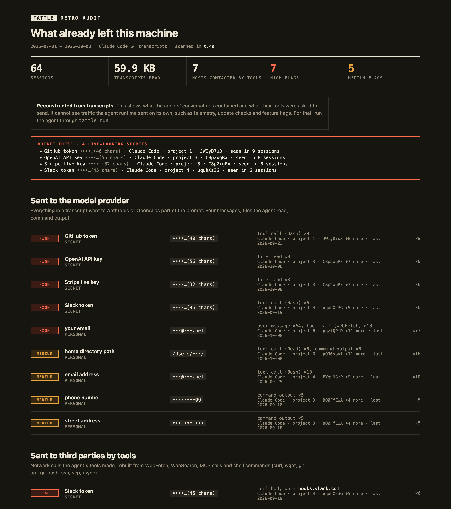

# tattle

**See what your coding agent already sent, and what it sends next.**

tattle audits coding agents (Claude Code, Codex) for secrets and personal data leaving your machine:

- **`tattle`** (retro audit): reads your past agent transcripts and reports what already went out. It covers what went to the model provider and what the agent's tools sent to third parties.
- **`tattle run -- <agent>`** (live proxy): runs an agent through a local proxy and logs every outbound HTTP(S) request, including the runtime's own telemetry.

Both flag API keys, tokens, private keys, `.env` contents, emails, phone numbers, street addresses, home paths, and your name, login or machine name. They show where each one went, with the value masked.



## Install

```sh
uv tool install git+https://github.com/colefoster/tattle
```

Requires Python 3.12+. `pipx install git+https://github.com/colefoster/tattle` also works.

## Retro: what already left

```sh
tattle                      # scan every past session, print a summary, write ~/.tattle/retro/report.html
tattle retro --since 30d    # only recent sessions (also 12h, 2w, 2026-10-01)
tattle retro --open         # open the HTML report
tattle retro --share        # stricter masking: project names and private hosts hidden too
```

It reads `~/.claude/projects/**/*.jsonl` (subagents included), `~/.codex/sessions/**`, archived Codex sessions and `~/.codex/history.jsonl`. The report keeps two channels apart:

1. **Sent to the model provider.** Everything in a transcript was part of a prompt: your messages, files the agent read, command output and tool calls. Each finding shows the session, when it was last seen, where it appeared (user message, file read, command output…) and a masked preview.
2. **Sent to third parties by tools.** Network calls rebuilt from WebFetch and WebSearch, web-ish MCP tools and shell commands: `curl`, `wget`, HTTPie, `gh api`, `git push/clone/fetch`, `ssh`, `scp`, `rsync`. URLs, query strings, headers (User-Agent, Authorization), `-u` credentials, credentials embedded in URLs and request bodies are all scanned. Localhost calls are left out.

Live-looking secrets are listed together under **Rotate these**. Values that look like docs or fixtures (`AKIA…EXAMPLE`, `fake`, low entropy) are kept separate as placeholders.

**Retro is reconstructed from transcripts.** It cannot see traffic the agent runtime sent on its own (telemetry, update checks, feature flags) or anything a command fetched indirectly. The live proxy catches that.

Transcripts are streamed one line at a time, and pasted screenshots are dropped before parsing. On a real Mac with 1,521 transcript files (3.7 GB, 1,559 sessions), a full scan took 87 s with a peak RSS of 128 MB.

## Live: what it sends next

```sh
tattle run -- claude -p "fetch example.com"   # run any command through the proxy
tattle run --live --open -- codex             # stream requests as they happen, open the report at the end
tattle tail                                   # live view of the latest session from another terminal
tattle report --open                          # rebuild and open the latest report
tattle report --share                         # stricter masking for a report you will show others
tattle proxy                                  # standalone proxy; prints the env vars to export
tattle ls                                     # list sessions
```

When the command exits, tattle prints a summary and writes `~/.tattle/sessions/<id>/report.html`:

```
tattle  25 requests · 4 hosts · 1.3 MB sent · 4 high · 2 medium · 2 expected auth
  high   .env-style DATABASE_PASSWORD hunt…(18 chars)   body → api.anthropic.com
  high   OpenAI API key               sk-p…(56 chars)   body → api.anthropic.com
  high   value from your .env         plan…(31 chars)   body → api.anthropic.com
  high   your email                   •••@•••.com       body → api.anthropic.com
  medium email address               •••@•••.net       body → api.anthropic.com
  medium home directory path         /Users/•••/       body → api.anthropic.com
```

## What it flags

| Category | Detectors |
| --- | --- |
| Secrets | Anthropic, OpenAI, AWS, GitHub, Slack, Stripe, Google and Hugging Face keys; private-key blocks; JWTs; `.env`-style `*_KEY=` / `*_TOKEN=` / `*_PASSWORD=` assignments; any value from a `.env*` file in the working directory |
| Personal | your git email (global and repo), your full name, login name, machine name, home-directory paths, other email addresses, phone numbers, street addresses, and any string you add to `~/.tattle/watch.txt` |

It scans the path, query string, every header and the decoded body. A credential in an `Authorization`, `x-api-key` or `Cookie` header is marked **expected**: it is how the agent signs in, so it is shown dimmed rather than as a leak. Hosts are grouped as model API, telemetry, packages & code, or web.

**Values are masked before anything touches disk.** The log and report keep a key's first four characters and its length, an email's first letters and TLD, and nothing else. `--share` drops even those and blanks account IDs in paths.

## How HTTPS works, and how to undo it

tattle runs [mitmproxy](https://mitmproxy.org) with a small addon. On first run mitmproxy creates a local CA in `~/.tattle/ca/`.

**tattle never installs that CA system-wide.** Only the process started by `tattle run` trusts it, through environment variables: `HTTPS_PROXY`, `NODE_EXTRA_CA_CERTS`, `SSL_CERT_FILE`, `REQUESTS_CA_BUNDLE`, `CURL_CA_BUNDLE`, `GIT_SSL_CAINFO` and `CODEX_CA_CERTIFICATE`. Your browser and other apps are untouched.

Teardown is one command:

```sh
tattle clean      # deletes ~/.tattle: the CA key and every session
```

A client that pins certificates or ignores those variables will refuse the connection. tattle records that as a refused interception, so it is not silently missing from the report.

## Real run: Claude Code, 2026-10-25

`tattle run -- claude -p "Fetch https://example.com and tell me its title in one line"` on a Mac:

- 27 requests to 5 hosts, 1.4 MB sent, in 12 seconds. The page fetch itself was a single 0-byte `GET example.com` (via `curl`).
- ~1.2 MB went to `api.anthropic.com` (prompts, config, event logging); 146 KB of logs went to Datadog; Claude Code also checked npm for two MCP packages.
- **Flagged:** the user's own email and home-directory path inside the prompt body sent to the model API. No secrets left in a URL, header or third-party request.

The same run in a project with a planted fake `.env` flagged the fake OpenAI key, the fake password and the fake email inside the request to `api.anthropic.com`, after the agent read the file.

## Limits

- It sees HTTP(S) only, not raw TCP, DNS or WebSockets frames.
- Pattern detection misses secrets with no recognisable shape that are not in a local `.env`.
- Localhost traffic bypasses the proxy (`NO_PROXY=localhost,127.0.0.1,::1`).

## Develop

```sh
uv sync && uv run pytest
```

MIT licensed.
